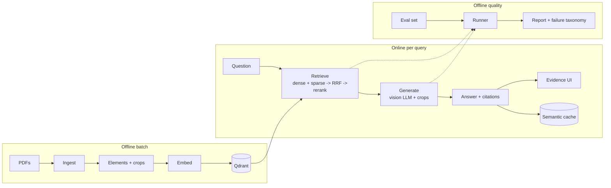

# Multimodal RAG

Grounded question answering over PDFs where evidence lives in text, tables, and figures.

The system is designed to return answers with verifiable citations (`doc_id`, `page`, `bbox`), show the underlying visual evidence, and abstain when support is insufficient. It is **read-only**: documents are ingested and queried, never modified.

## Project status

| Stage | Module(s) | Status |
|---|---|---|
| Contracts | `src/ingestion/elements.py`, `src/config.py` | Implemented and tested |
| Ingestion | `src/ingestion/` | Implemented and tested on 3 arXiv papers |
| Embedding | `src/embedding/` | Implemented; 816 elements stored in embedded Qdrant |
| Retrieval | `src/retrieval/` | Specified, not implemented |
| Generation | `src/generation/` | Specified, not implemented |
| Caching | `src/caching/` | Specified, not implemented |
| Evaluation | `src/evaluation/` | Specified, not implemented |
| UI | `src/ui/` | Specified, not implemented |

> This README does not claim measured retrieval or answer quality. Metrics are reported only after an evaluation run produces them.

## Key capabilities

- **Layout-aware ingestion** — preserves figures with captions, keeps tables intact, and records a bounding box for every element.
- **Multimodal representations** — figures can carry both a caption/text representation and a CLIP image embedding (ADR-013).
- **Visual grounding** — generation is designed to receive actual image crops, not summaries alone.
- **Traceable citations** — answers cite `doc_id`, `page`, and `bbox` rather than chunk indexes.
- **Measured evaluation (planned)** — retrieval and answer quality reported separately, with cache disabled and a failure taxonomy.

## Architecture



Details: [`docs/architecture.md`](docs/architecture.md).

## Quickstart

### Prerequisites

- **Python 3.12** (pinned; see [ADR-008](DECISIONS.md))
- **uv** recommended (`pip` also works)
- **Windows (CPU PyTorch):** Microsoft Visual C++ 2015–2022 Redistributable **14.40+** is required for PyTorch wheels ≥ 2.15. Older redistributables can fail with `WinError 126` (`VCRUNTIME140_THREADS.dll` missing).

  ```powershell
  winget upgrade --id Microsoft.VCRedist.2015+.x64
  ```

  Without admin rights, you can pin an older wheel instead:

  ```bash
  uv pip install "torch<2.15" --index-url https://download.pytorch.org/whl/cpu
  ```

### Setup

```bash
git clone <repo-url>
cd multimodal-rag
python -m uv venv --python 3.12
python -m uv pip install -e ".[dev,embed,store]"
cp .env.example .env   # configure keys as needed; never commit .env
```

### Verify the environment

```bash
python scripts/smoke_test.py                 # interpreter, imports, embedded Qdrant
python scripts/smoke_test.py --with-models   # also loads embedding models
pytest -q
```

### 1. Probe the corpus

Inspect documents before ingestion to understand OCR needs, table regions, figures, and render cost.

```bash
python scripts/probe_corpus.py data/raw --json data/processed/corpus_probe.json
```

### 2. Ingest PDFs

```bash
python scripts/ingest.py data/raw
```

Outputs:

- `data/processed/elements.jsonl` — element manifest
- `data/processed/<doc_id>/<element_id>.png` — rendered crops

Ingestion is read-only and idempotent. It drops headers/footers, filters over-detected tables, renders vector figures from bounding boxes, and links PDF captions to figures/tables (ADR-014).

### 3. Embed and store

```bash
python scripts/embed.py --dry-run     # validate manifest without loading models
python scripts/embed.py --no-captions # embed using captions already present in the PDF
python scripts/embed.py               # caption (if approved) + embed + write to Qdrant
```

Embedding writes text vectors (sentence-transformers) and figure image vectors (CLIP) into an embedded Qdrant collection (ADR-013, ADR-015). The physical collection name encodes vector dimensions (for example, `elements_v1_t384i512`) and is the value retrieval must resolve.

Hosted captioning runs only when `CAPTION_ALLOW_HOSTED=true` and a valid API key is configured.

### Planned commands

```bash
python scripts/query.py "What was Q3 revenue?"
python scripts/evaluate.py
streamlit run src/ui/app.py
```

## Repository structure

```text
.
├── AGENTS.md              # root agent/developer instructions
├── DECISIONS.md           # architecture decision records (ADRs)
├── README.md
├── pyproject.toml         # dependencies and tool configuration
├── .env.example           # configuration contract
├── data/
│   ├── raw/               # source PDFs (gitignored, read-only)
│   ├── processed/         # generated elements/crops (gitignored)
│   └── eval_set/          # labeled questions (committed)
├── docs/                  # architecture, stage guides, evaluation
├── scripts/
│   ├── probe_corpus.py
│   ├── ingest.py
│   ├── embed.py
│   └── smoke_test.py
├── src/
│   ├── config.py
│   ├── ingestion/         # parser, layout, tables, crops, elements
│   ├── embedding/         # store, text, image, caption
│   ├── retrieval/         # planned
│   ├── generation/        # planned
│   ├── caching/           # planned
│   ├── evaluation/        # planned
│   └── ui/                # planned
└── tests/
```

Each module has a scoped `AGENTS.md` describing its contract, rules, and tests.

## Design invariants

1. **Figures keep their captions** (or an explicit caption link).
2. **Tables are not split within a page**; cross-page tables are linked via `metadata.table_group`.
3. **Bounding boxes are preserved** as `(x0, y0, x1, y1)` in page coordinates.
4. **Citations use `doc_id`, `page`, and `bbox`**, not chunk indexes.
5. **Pydantic models are used across module boundaries** (no ad hoc dictionaries).
6. **Ingestion and embedding are idempotent** per document/model configuration.
7. **Generated artifacts are reproducible** from source data and configuration.
8. **The system is read-only**.

## Evaluation

Evaluation is designed to measure retrieval and answer quality separately, with caching disabled.

| Layer | Planned metrics |
|---|---|
| Retrieval | Recall@k, MRR, image recall@k (by element type) |
| Generation | Faithfulness, citation correctness, answer relevancy, abstention accuracy |

Each run should record seed, model versions, config hash, and corpus hash. The eval set must include questions answerable only from figures/tables and an unanswerable split for abstention. See [`docs/evaluation.md`](docs/evaluation.md) and [`docs/failure-taxonomy.md`](docs/failure-taxonomy.md).

## Open decisions

| # | Decision | Current default |
|---|---|---|
| 1 | `unstructured` or PyMuPDF-only? | **Resolved:** PyMuPDF-only (ADR-009) |
| 2 | Is OCR needed? | **Resolved:** No for v0 corpus (ADR-009) |
| 3 | Package layout (`src/` vs `src/multimodal_rag/`) | Keep `src/` |
| 4 | Caption source (hosted vs local LLaVA) | Hosted, with approval gate |
| 5 | Reranker strategy | None in v0; add after baseline |
| 6 | Cache scope | Answer-only in v0 |
| 7 | Faithfulness judging method | LLM judge (pinned model/prompt) |
| 8 | Production text embedding model | `all-MiniLM-L6-v2` for initial baseline |
| 9 | PyMuPDF table over-detection | **Mitigated:** 25/39 regions kept (ADR-014); human spot-check advised |

## Documentation

| Document | Purpose |
|---|---|
| [`AGENTS.md`](AGENTS.md) | Root instructions, scope, data model, conventions |
| [`DECISIONS.md`](DECISIONS.md) | Architecture decision records (ADRs) |
| [`docs/architecture.md`](docs/architecture.md) | System stages, data flow, invariants |
| [`docs/ingestion.md`](docs/ingestion.md) | Ingestion guide, thresholds, baseline, limits |
| [`docs/embedding.md`](docs/embedding.md) | Embedding guide, storage layout, verification |
| [`docs/eval-set.md`](docs/eval-set.md) | Eval-set authoring and validation |
| [`docs/evaluation.md`](docs/evaluation.md) | Metrics and evaluation methodology |
| [`docs/failure-taxonomy.md`](docs/failure-taxonomy.md) | Observed failure classes |
| `src/<module>/AGENTS.md` | Module-level contracts and rules |

## Stack

| Layer | Choice |
|---|---|
| Language | Python 3.12, type hints, Pydantic v2 |
| PDF rendering | PyMuPDF 1.x (`<2`) |
| Parsing/tables | PyMuPDF (`find_tables`) with filtered heuristics |
| Captions | Hosted VLM by default (approval-gated); local LLaVA planned |
| Text embeddings | sentence-transformers |
| Image embeddings | CLIP (ViT-B/32), figures only |
| Vector store | Qdrant (embedded mode in v0) |
| Generation | Vision-capable LLM behind an interface (planned) |
| Caching | In-process semantic cache (planned) |
| UI | Streamlit (planned) |
| Evaluation | Custom metrics + partial RAGAS (planned) |

## Safety and privacy

- **Read-only system:** no external write actions (email, post, payment, merge, delete).
- **Untrusted content:** document text and model outputs are treated as data, not instructions.
- **Sensitive data handling:** hosted captioning/vision calls require explicit approval; prefer local processing for sensitive documents.
- **PII awareness:** flag sensitive content; do not silently expose it.
- **Secrets management:** load keys from `.env` or environment variables; `.env` is gitignored.
