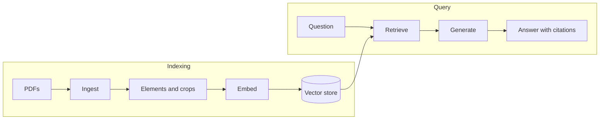

# Multimodal RAG

Grounded question answering over PDFs, with citations to the source text, tables, and figures.

## Status

| Stage | Status |
|---|---|
| Ingestion | Implemented |
| Embedding | Implemented |
| Retrieval | Planned |
| Generation | Planned |
| Evaluation | Planned |
| UI | Planned |

> Retrieval and answer quality are not yet measured.

## Architecture



See [`docs/architecture.md`](docs/architecture.md) for more detail.

## Getting started

### Setup

```bash
git clone <repo-url>
cd multimodal-rag
uv venv --python 3.12
uv pip install -e ".[dev,embed,store]"
cp .env.example .env
```

### Verify

```bash
python scripts/smoke_test.py
pytest -q
```

### Usage

1. **Probe documents**
   ```bash
   python scripts/probe_corpus.py data/raw --json data/processed/corpus_probe.json
   ```

2. **Ingest PDFs**
   ```bash
   python scripts/ingest.py data/raw
   ```
   Produces `data/processed/elements.jsonl` and cropped images under `data/processed/<doc_id>/`.

3. **Embed elements**
   ```bash
   python scripts/embed.py --dry-run
   python scripts/embed.py --no-captions
   ```

## Repository structure

```text
.
├── src/            # application modules
├── scripts/        # CLI entry points
├── docs/           # architecture and guides
├── data/           # source files, processed artifacts, eval set
├── tests/          # automated tests
├── AGENTS.md
├── DECISIONS.md
└── README.md
```

## Documentation

- [`docs/architecture.md`](docs/architecture.md) — system design and data flow
- [`docs/ingestion.md`](docs/ingestion.md) — ingestion guide
- [`docs/embedding.md`](docs/embedding.md) — embedding and storage guide
- [`docs/evaluation.md`](docs/evaluation.md) — evaluation methodology
- [`DECISIONS.md`](DECISIONS.md) — architecture decisions

## Safety

- Source documents are processed in read-only mode.
- Document content and model outputs are treated as untrusted data.
- Configuration and secrets are loaded from the environment. `.env` files are not committed.
