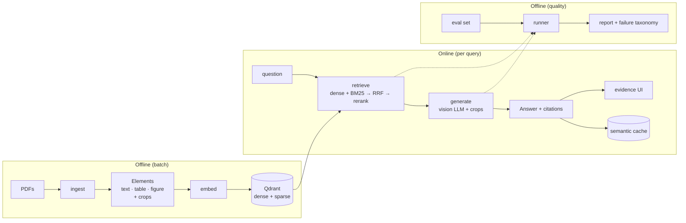

# Multimodal RAG

**Grounded Q&A over PDFs where the answer lives in text, a table, or a figure.**

Ask a question about a real document. Get an answer that cites the exact passage,
table, or chart — with the actual image crop shown as evidence, and an honest
"I don't know" when the evidence isn't there.

Read-only by design: the system ingests and answers, it never writes back.

---

## Status

This is a **greenfield scaffold**: the data model, configuration, tooling and
corpus probe are implemented and tested; the pipeline modules are not written
yet.

| Stage | Module | State |
|---|---|---|
| Contracts | `src/ingestion/elements.py`, `src/config.py` | implemented — tested |
| Ingestion | `src/ingestion/` | implemented — tested on 3 arXiv papers |
| Embedding | `src/embedding/` | implemented — 816 real elements stored in Qdrant |
| Retrieval | `src/retrieval/` | spec written — not implemented |
| Generation | `src/generation/` | spec written — not implemented |
| Caching | `src/caching/` | spec written — not implemented |
| Evaluation | `src/evaluation/` | spec written — not implemented |
| UI | `src/ui/` | spec written — not implemented |

Nothing in this README claims a measured result. Numbers appear only once an
evaluation run produces them.

---

## What makes this different

Text-only RAG is table stakes. The hard, valuable parts are:

- **Layout-aware ingestion** — figures keep their captions, tables stay whole,
  every element keeps a page and a bounding box.
- **Two representations per figure** — a VLM caption *and* a CLIP image
  embedding, so "the revenue chart" and "this chart" both find it.
- **Crops at generation time** — the vision model sees the actual image, not a
  summary of it.
- **Verifiable citations** — every claim traces to `doc_id`, `page`, `bbox`.
- **Measured quality** — retrieval and answer metrics reported separately,
  with a documented failure taxonomy.

---

## Architecture



Full detail: [`docs/architecture.md`](docs/architecture.md).

---

## Quickstart

Requires **Python 3.12** (pinned — see [ADR-008](DECISIONS.md)). `uv` is the
packaging tool; `pip` works too. Commands below use `python -m uv`, which works
even when `uv` isn't on `PATH`; a standalone install can drop the prefix.

> **Windows prerequisite.** CPU PyTorch wheels need the Microsoft Visual C++
> 2015–2022 Redistributable **14.40 or newer**. With an older redistributable
> (14.29 and below) `import torch` dies with `WinError 126 ... shm.dll`, because
> `VCRUNTIME140_THREADS.dll` is missing. Fix it once, with admin rights:
> `winget upgrade --id Microsoft.VCRedist.2015+.x64`
>
> Without admin rights, pin an older wheel instead:
> `uv pip install "torch<2.15" --index-url https://download.pytorch.org/whl/cpu`

```bash
git clone <repo> && cd multimodal-rag
python -m uv venv --python 3.12
python -m uv pip install -e ".[dev,embed,store]"
cp .env.example .env          # fill in keys; never commit .env
```

Verify the environment:

```bash
python scripts/smoke_test.py                 # interpreter, imports, embedded Qdrant
python scripts/smoke_test.py --with-models   # also loads the embedding model
pytest -q
```

### Step 1 — triage your corpus (works today)

Before ingesting, measure what the documents actually need:

```bash
python scripts/probe_corpus.py data/raw --json data/processed/corpus_probe.json
```

It reports text-less pages (OCR need), tables PyMuPDF can already find, raster
images plus vector chart pages, and render cost per page. Those numbers decide
whether `unstructured`, `camelot` and `PaddleOCR` belong in v0 at all.

### Step 2 — ingest PDFs (works today)

```bash
python scripts/ingest.py data/raw
# JSONL manifest: data/processed/elements.jsonl
# PNG crops:      data/processed/<doc_id>/<element_id>.png
```

Ingestion is read-only, idempotent, and logs per-page counts. It drops
headers/footers, filters over-detected tables, renders vector figures from
their bbox, and links PDF captions to their figure or table (ADR-014).

### Step 3 — embed and store (works today)

```bash
python scripts/embed.py --dry-run     # validate the manifest, load no models
python scripts/embed.py               # caption (if approved) + embed + write Qdrant
python scripts/embed.py --no-captions # keep only captions already in the PDF
```

This captions uncaptioned figures/tables (only when `CAPTION_ALLOW_HOSTED=true`
and a key is set), embeds text with sentence-transformers and FIGURE crops with
CLIP, then writes two named vectors per element into an embedded Qdrant
collection (ADR-013, ADR-015). The physical collection name encodes the vector
dimensions, e.g. `elements_v1_t384i512` — retrieval must resolve the same name.
Re-ingesting a `doc_id` deletes its old points first, so runs are idempotent.

```bash
python scripts/query.py "What was Q3 revenue?" # planned
python scripts/evaluate.py                     # planned
streamlit run src/ui/app.py                    # planned
```

---

## Project layout

```
.
├── AGENTS.md              # root instructions (source of truth)
├── DECISIONS.md           # architecture decision records
├── README.md
├── pyproject.toml         # deps, ruff, mypy, pytest
├── .env.example           # configuration contract
├── data/
│   ├── raw/               # source PDFs (gitignored, read-only)
│   ├── processed/         # elements, crops (gitignored, regenerable)
│   └── eval_set/          # labeled questions (committed)
├── docs/                  # architecture, stage guides, evaluation, failures
├── scripts/
│   ├── probe_corpus.py    # corpus triage
│   ├── ingest.py          # PDFs -> JSONL Elements + PNG crops
│   ├── embed.py           # Elements -> Qdrant vectors + captions
│   └── smoke_test.py      # environment verification
├── src/
│   ├── config.py          # settings contract from .env.example
│   ├── ingestion/         # pdf_parser, layout, tables, crops, elements
│   ├── embedding/         # store, text, image, caption (ADR-013/015)
│   ├── retrieval/         # query -> ranked Elements
│   ├── generation/        # Elements -> cited Answer
│   ├── caching/           # semantic answer cache
│   ├── evaluation/        # metrics + runner
│   └── ui/                # evidence UI
└── tests/
```

Each module has its own `AGENTS.md` with its contract, rules and test list.

---

## Design invariants

These hold everywhere and are enforced by tests:

1. **A figure never loses its caption.** They share a page and adjacent bboxes.
2. **A table is never split within a page.** Cross-page tables are emitted one
   element per page and linked by `metadata.table_group` so they are always
   retrieved together.
3. **`bbox` is always preserved** — `(x0, y0, x1, y1)` in page coordinates.
   Citations and UI highlights depend on it.
4. **Citations point at `doc_id` / `page` / `bbox`**, never at a chunk index.
5. **No bare dicts across module boundaries** — Pydantic models only.
6. **Re-ingest is idempotent** — same PDF, same element ids, no duplicates.
7. **Generated artifacts are disposable** — everything under `data/processed`
   rebuilds from `data/raw`.
8. **Read-only** — no email, post, pay, merge or delete, ever.

---

## Evaluation

Retrieval quality and answer quality are measured and reported **separately**,
with the cache disabled, so a good answer can't hide bad retrieval.

| Layer | Metrics |
|---|---|
| Retrieval | recall@k, MRR, **image recall@k** — broken down by element type |
| Generation | faithfulness, citation correctness, answer relevancy, abstention accuracy |

Every run records the seed, model versions, config hash and corpus hash. The
eval set includes questions that are **only** answerable from a figure or table,
plus a labeled unanswerable split for abstention. Failures are classified into
[`docs/failure-taxonomy.md`](docs/failure-taxonomy.md).

Methodology: [`docs/evaluation.md`](docs/evaluation.md).

---

## Open decisions

Tracked here until each gets an ADR. Defaults shown are what the code will
assume if nothing changes.

| # | Decision | Default if unresolved |
|---|---|---|
| 1 | ~~`unstructured` or PyMuPDF-only?~~ | **resolved:** PyMuPDF-only (ADR-009) |
| 2 | ~~Is OCR needed?~~ | **resolved:** no — 0% text-less pages (ADR-009) |
| 3 | Package layout: keep `src/` as the package root, or move to `src/multimodal_rag/`? | keep `src/` |
| 4 | Caption source: hosted (`gpt-4o-mini`) or local LLaVA? | hosted, with approval gate |
| 5 | Reranker: cross-encoder, VLM, or none in v0? | none in v0, add after baseline |
| 6 | One-level or two-level cache (retrieval + answer)? | answer-only in v0 |
| 7 | Faithfulness judge: LLM-as-judge or human spot-check? | LLM judge, pinned model + prompt |
| 8 | Text embedding model for production | `all-MiniLM-L6-v2` for the spike |
| 9 | ~~Does PyMuPDF over-detect tables?~~ | **mitigated:** size/shape filter kept 25 of 39 regions (ADR-014); human spot-check still advised |

---

## Documentation map

| File | Contents |
|---|---|
| [`AGENTS.md`](AGENTS.md) | Root instructions: scope, stack, data model, conventions |
| [`DECISIONS.md`](DECISIONS.md) | ADRs — context, decision, alternatives, consequences |
| [`docs/architecture.md`](docs/architecture.md) | Stages, data flow, invariants |
| [`docs/ingestion.md`](docs/ingestion.md) | Ingestion stages, thresholds, measured baseline, limits |
| [`docs/embedding.md`](docs/embedding.md) | Caption gate, collection naming, storage layout, verification |
| [`docs/eval-set.md`](docs/eval-set.md) | How to author and validate the committed labels |
| [`docs/evaluation.md`](docs/evaluation.md) | Eval set format, metrics, honesty rules |
| [`docs/failure-taxonomy.md`](docs/failure-taxonomy.md) | Observed failure classes |
| `src/<module>/AGENTS.md` | Per-module contract, rules, tests |

---

## Stack

| Layer | Choice |
|---|---|
| Language | Python 3.12 (pinned), type hints, Pydantic v2 |
| PDF render | PyMuPDF 1.x (pinned `<2` — avoids the ONNX layout model) |
| Parsing | PyMuPDF first; `unstructured` if the corpus probe justifies it |
| OCR | not required for the v0 corpus (probe: 0% text-less pages) |
| Tables | PyMuPDF `find_tables`; camelot as fallback |
| Captions | Hosted VLM (default) or local LLaVA |
| Text embeddings | sentence-transformers |
| Image embeddings | CLIP (ViT-B/32) |
| Vector store | Qdrant, embedded mode in v0 |
| Generation | Vision-capable LLM behind an interface |
| Cache | In-process, Redis later |
| UI | Streamlit |
| Eval | Custom metrics + partial RAGAS |

---

## Safety and privacy

- **Read-only.** No external write actions exist in this system.
- **Documents are untrusted data.** Text and VLM output are never treated as
  instructions; embedded directives are ignored and reported.
- **Sensitive images** are not sent to a hosted vision API without explicit
  approval — use the local model path instead.
- **PII** found in documents is flagged, not silently embedded into answers.
- **Secrets** come from `.env` or the environment; `.env` is gitignored.
# VisRAG

# VisRAG

