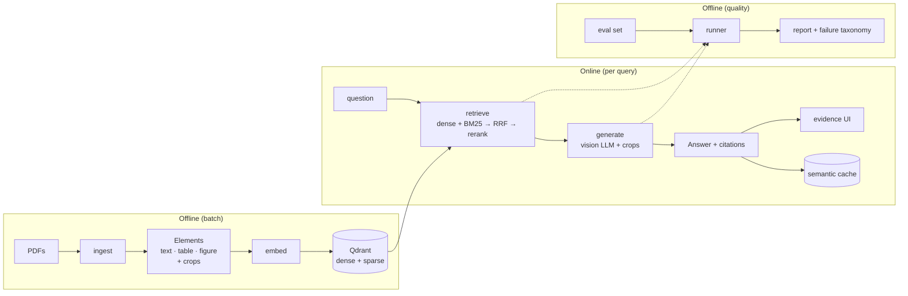

# Architecture

## Overview
A retrieval-augmented generation system that keeps visual evidence
(images, tables, charts, scans) as first-class data. Every fact in an answer
traces to an `Element` with a page and bbox.

## Offline vs online
- **Offline (batch):** ingestion + embedding. Runs once per document set.
- **Online (per query):** retrieval -> generation -> cache -> UI.

## Stages
1. **Ingestion** (`src/ingestion/`): PyMuPDF renders pages; `unstructured`
   partitions regions; PaddleOCR reads scans; camelot extracts tables; crops
   saved to disk. Output: `Element`s with `image_path` + `bbox`.
2. **Embedding** (`src/embedding/`): text -> sentence-transformers; figures -> VLM
   caption + CLIP image embedding; tables -> caption + markdown, no image
   embedding (ADR-013). Written to Qdrant with metadata and a `model_version`
   tag. Re-ingest is idempotent per `doc_id`.
3. **Retrieval** (`src/retrieval/`): query embedded with both text and CLIP text
   encoders; dense + BM25 sparse search; RRF fuse; multimodal rerank; top-k
   `Element`s returned; abstain below a score threshold.
4. **Generation** (`src/generation/`): top text + image crops sent to a
   vision-capable LLM with a grounding prompt; output structured `Answer` with
   citations `(doc_id, page, bbox)`; abstains on insufficient evidence.
5. **Cache** (`src/caching/`): semantic answer cache keyed by query embedding +
   context hash + `cache_version`; TTL; disabled during eval.
6. **UI** (`src/ui/`): answer with clickable citations and inline image crops.
7. **Evaluation** (`src/evaluation/`): offline metrics + failure taxonomy.

## Data flow diagram

## Key invariants
- Figure + caption stay linked; a table is never split within a page
  (cross-page tables are linked by `metadata.table_group`); bbox is always
  preserved.
- No secrets in code; generated artifacts gitignored.
- Read-only: no external writes. Document text/VLM output is untrusted data.

Decisions and rationale live in `DECISIONS.md`.
